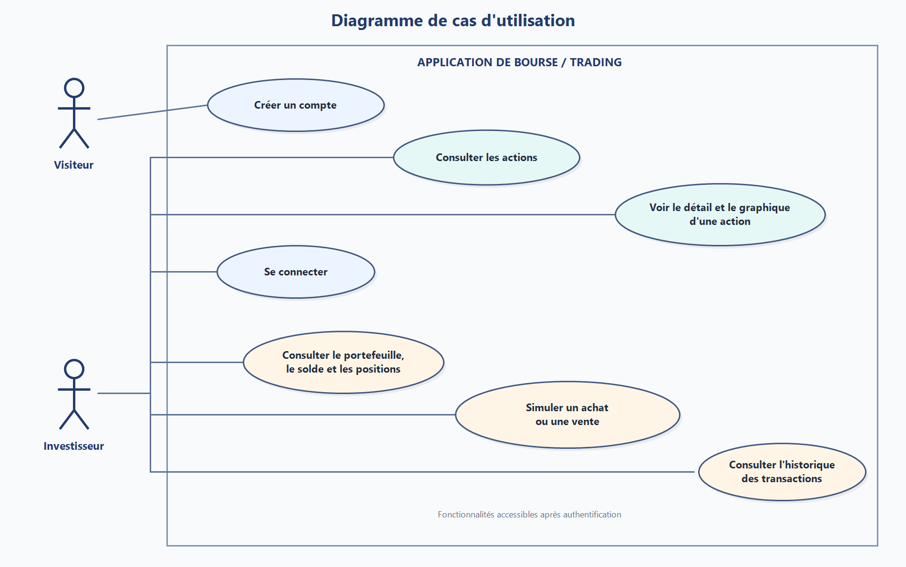
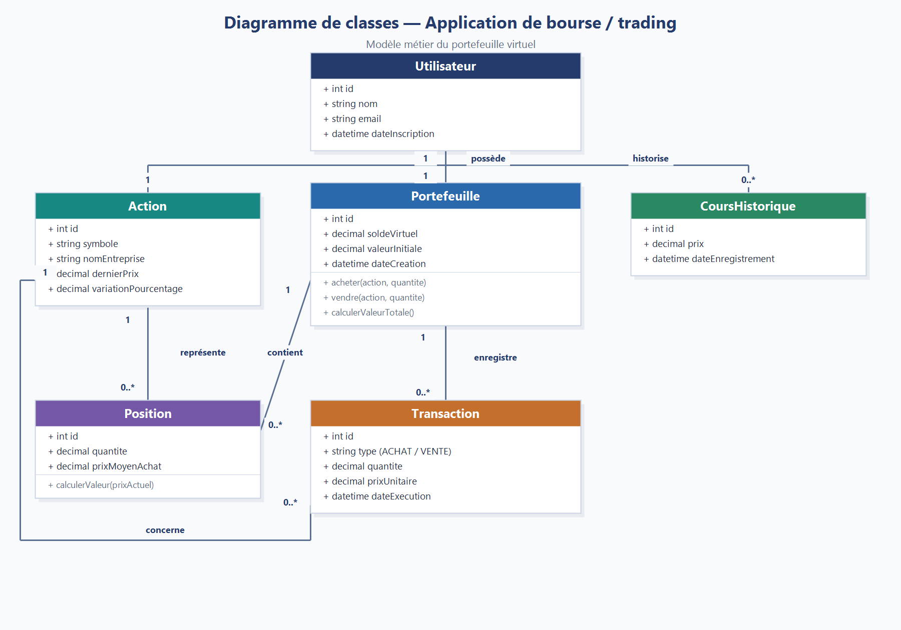

<!-- _class: title-slide -->

# Rapport de projet TradeSim

### Virtual Stock Trading Platform

  
  

**Solaiman Chatt**

Encadrant : ES-Sarraj Fouad

Année de formation : 2026–2027

---

## Remerciements

---

## Introduction

- Présentation du domaine de la bourse et du trading.
- Importance de l'apprentissage des marchés financiers.
- Présentation générale de TradeSim.
- Objectifs du projet.

---

## Contexte du projet

- Difficulté pour les débutants de découvrir le marché boursier.
- Risques financiers liés à la pratique du trading réel.
- Besoin d'un environnement d'apprentissage accessible.
- Nécessité de proposer une solution de simulation sans risque financier.

---

## Méthode de travail

- Organisation du travail.
- Méthodologie de développement.
- Analyse et conception.
- Développement et validation.

---

<!-- _class: image-only -->

## Scrum

---

<!-- _class: image-only -->

## Processus 2TUP

---

<!-- _class: image-only -->

## Design Thinking

---

## Planification

- Analyse des besoins.
- Conception de la plateforme.
- Développement des fonctionnalités.
- Intégration des données boursières.
- Tests et validation.

[Insérer le planning prévisionnel du projet.]

---

## Branche fonctionnelle

**Acteurs principaux :**

- Visiteur.
- Utilisateur.
- Administrateur.

**Fonctionnalités principales :**

- Gestion des comptes utilisateurs.
- Consultation des actions boursières.
- Suivi des prix et des évolutions.
- Gestion du portefeuille virtuel.
- Simulation des achats et ventes.
- Consultation de l'historique des transactions.

---

## Carte d'empathie

**Utilisateur cible : Débutant en trading**

- Que pense-t-il et ressent-il ?
- Que voit-il sur le marché financier ?
- Qu'entend-il sur le trading ?
- Que dit-il et fait-il ?
- Quels sont ses besoins et ses difficultés ?

[Insérer la carte d'empathie de TradeSim.]

---

## Définition du problème

**Problématique :**

Comment permettre aux personnes débutantes de découvrir et de pratiquer le trading dans un environnement accessible, pédagogique et sans risque financier réel ?

**Besoin identifié :**

Une plateforme permettant de suivre les actions et de simuler des opérations boursières à l'aide d'un portefeuille virtuel.

---

## Idéation

**Solution proposée : TradeSim**

- Créer un compte utilisateur.
- Consulter les actions disponibles.
- Visualiser l'évolution des prix.
- Disposer d'un solde virtuel initial.
- Simuler des opérations d'achat et de vente.
- Suivre les performances du portefeuille.
- Consulter l'historique des transactions.

---

<!-- _class: diagram-slide -->

## Diagramme de cas d'utilisation

---

## Stack technologique

- **Backend** · PHP / Laravel [à confirmer]
- **Frontend** · HTML · Tailwind CSS · JavaScript
- **Base de données** · MySQL
- **Visualisation** · Chart.js
- **Données financières** · API boursière / Données simulées
- **Modélisation** · Mermaid · PlantUML
- **Versionnement** · Git · GitHub

---

## Architecture

---

## Maquettes

[Insérer les maquettes UI/UX de TradeSim.]

- Page d'accueil.
- Page de connexion et inscription.
- Dashboard.
- Liste des actions.
- Détails d'une action.
- Portefeuille virtuel.

---

<!-- _class: diagram-slide -->

## Diagramme de classes

---

## Réalisation

**Présentation des fonctionnalités développées :**

- Interface utilisateur.
- Authentification.
- Consultation des actions.
- Gestion du portefeuille virtuel.
- Simulation des transactions.
- Calcul des profits et des pertes.
- Historique des opérations.

[Insérer les captures d'écran de l'application.]

---

## Conclusion
